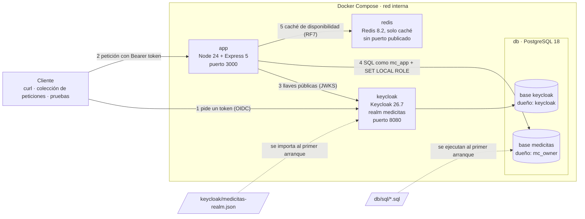
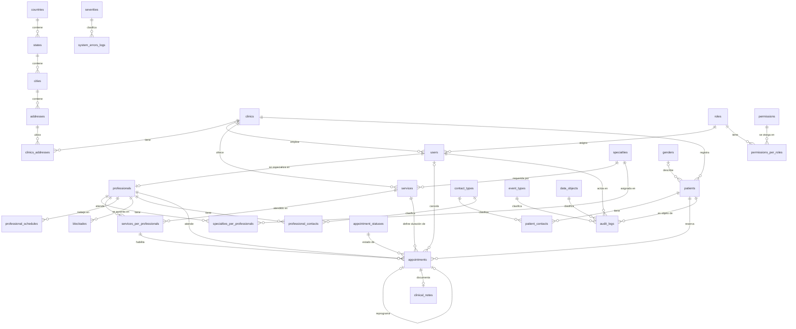
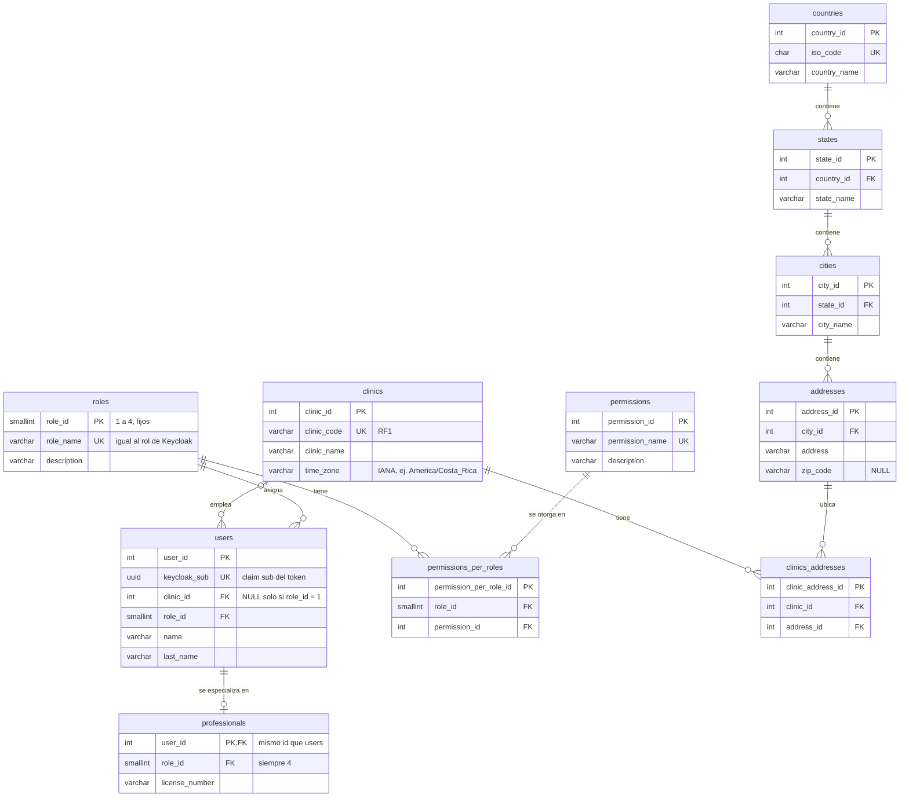
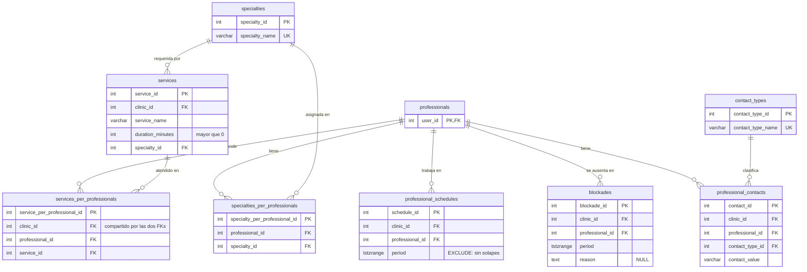
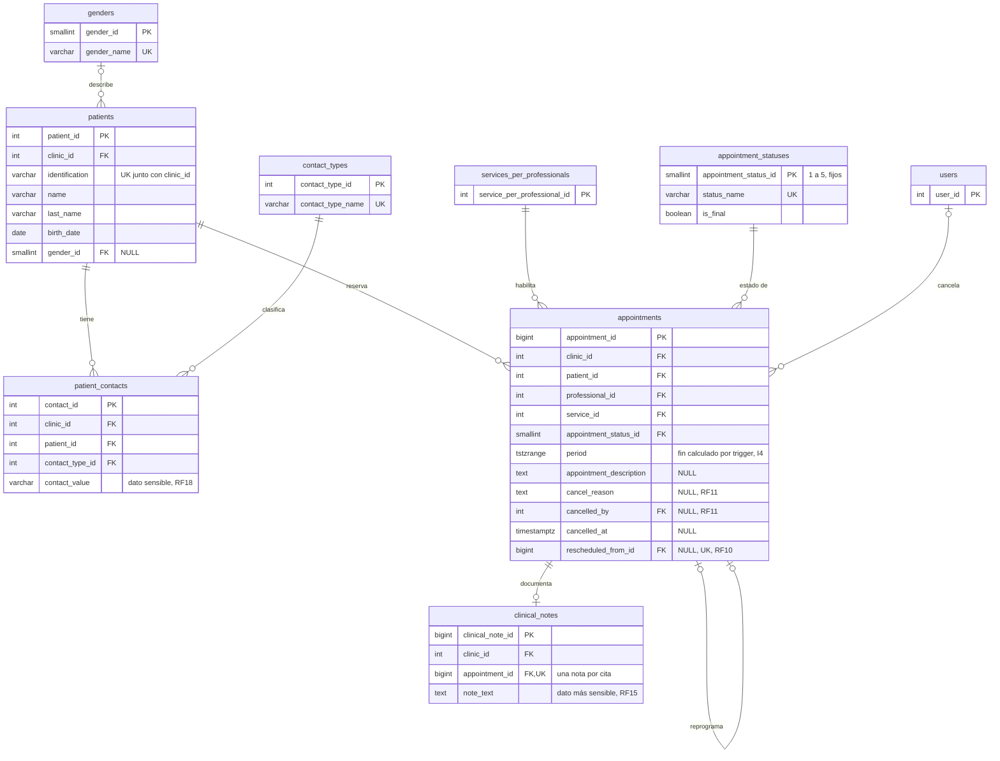
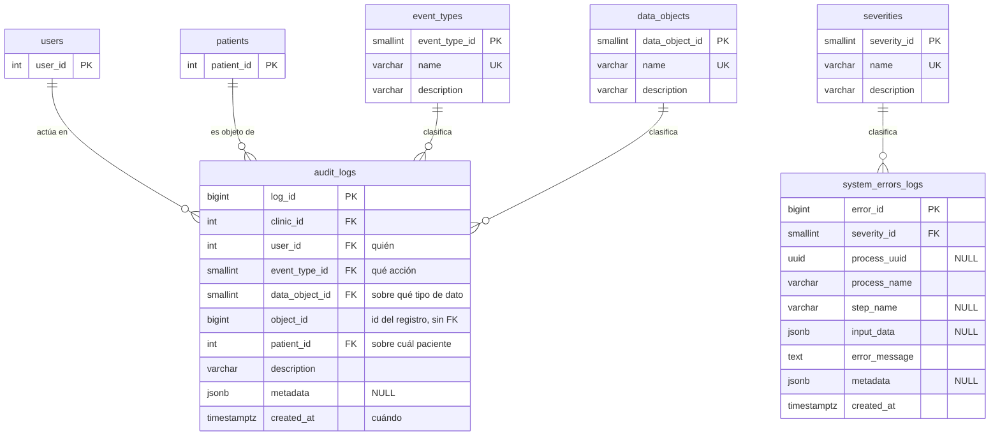

# Diagramas de MediCitas

Los diagramas usan [Mermaid](https://mermaid.js.org/), que GitHub dibuja directamente al ver este archivo.
Los nombres son los del esquema real (`db/sql/01-schema.sql`), en snake_case.

## 1. Arquitectura (Docker Compose)

El `sub` de cada token es el `keycloak_sub` de una fila de `users`: los ids de los usuarios de prueba están
fijados en `keycloak/medicitas-realm.json` y en `db/sql/04-seed.sql`, así que siempre coinciden.

## 2. Modelo entidad-relación: vista general

Para que el diagrama se pueda leer se omiten dos cosas que tienen casi todas las tablas:

- la relación `updated_by → users` (quién modificó el registro por última vez);
- las columnas de control `is_active`, `created_at`, `updated_at`, `updated_by`.

Las tablas de la clínica (agenda, contactos, citas, notas, bitácora) llevan `clinic_id`, pero no apuntan
directamente a `clinics`: lo hacen con FKs compuestas `(clinic_id, id)` hacia `users`, `patients`,
`services` o `appointments`, lo que obliga a que ambos registros sean de la misma clínica (I5).

## 3. Detalle por área

Mismas omisiones que en la vista general. `PK` llave primaria, `FK` llave foránea, `UK` único.

### 3.1 Clínicas, usuarios y permisos

### 3.2 Servicios y agenda

### 3.3 Pacientes, citas y notas clínicas

### 3.4 Bitácoras

